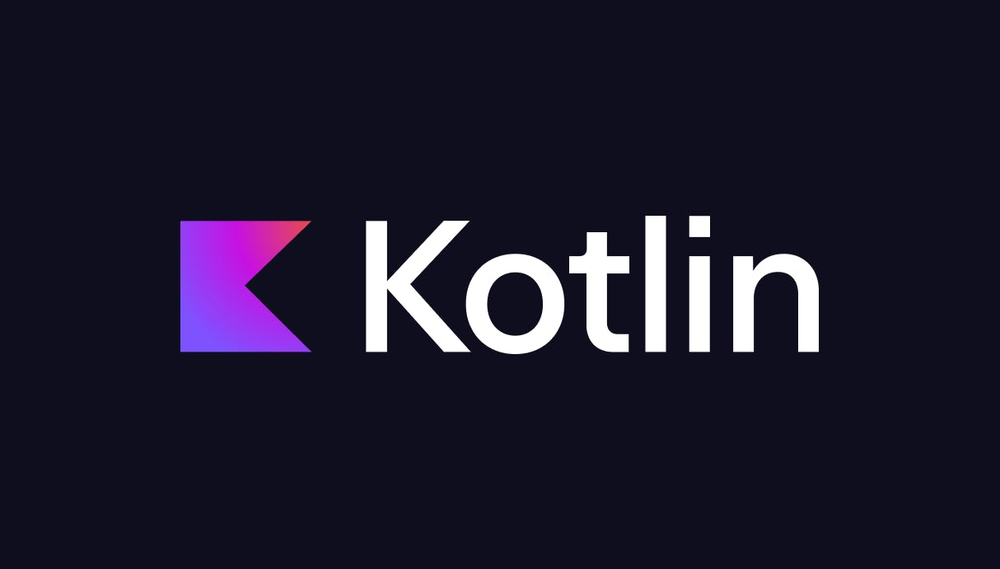

<h1 align="center">Jetpack Compose Playground<br/>
    <sub>Kotlin と Jetpack Compose で作る Android アプリのためのスケルトンとレッスン集</sub>
</h1>

<p align="center">
    
</p>

<p align="center">
    
    
    
    
    
    
</p>

---

<a id="table-of-contents"></a>
## 目次

<p align="center">
    <a href="README.md">English</a> ·
    <a href="README.vi.md">Tiếng Việt</a> ·
    <a href="README.es.md">Español</a> ·
    <a href="README.de.md">Deutsch</a> ·
    <a href="README.fr.md">Français</a> ·
    <a href="README.hi.md">हिन्दी</a> ·
    <b>日本語</b> ·
    <a href="README.ko.md">한국어</a>
</p>

1. [はじめに](#1-introduction)
2. [主な特徴](#2-highlights)
3. [はじめ方](#3-getting-started)
   - [必要な環境](#31-requirements)
   - [ビルドと実行](#32-build-and-run)
   - [設定](#33-configuration)
4. [技術スタック](#4-tech-stack)
5. [アーキテクチャ](#5-architecture)
   - [レイヤー](#51-layers)
   - [画面の構成](#52-screen-anatomy)
   - [ナビゲーション](#53-navigation)
   - [サンプルカタログ](#54-sample-catalog)
6. [アプリの流れ](#6-app-flow)
7. [レッスン](#7-lessons)
   - [UI とレイアウト](#71-ui-and-layout)
   - [アニメーションとグラフィックス](#72-animation-and-graphics)
   - [テキスト入力](#73-text-input)
   - [データとネットワーク](#74-data-and-networking)
   - [権限とデバイス機能](#75-permissions-and-device-features)
   - [メディアとバックグラウンド処理](#76-media-and-background-work)
   - [Kotlin とコルーチン](#77-kotlin-and-coroutines)
8. [ボトムバーのタブ](#8-bottom-bar-tabs)
9. [再利用可能なコンポーネントライブラリ](#9-reusable-component-library)
   - [コアコンポーネント](#91-core-components)
   - [カスタムビュー](#92-custom-views)
   - [チャート](#93-charts)
   - [Modifier](#94-modifiers)
   - [ユーティリティ](#95-utilities)
10. [通知とロック画面](#10-notifications-and-lock-screen)
11. [多言語対応とテーマ](#11-localization-and-theming)
12. [パフォーマンス: Baseline Profile](#12-performance-baseline-profile)
13. [プロジェクト構成](#13-project-structure)
14. [新しいレッスンの追加](#14-adding-a-new-lesson)
15. [作業中の項目](#15-work-in-progress)
16. [参考記事一覧](#16-reading-list)
17. [AI を活用した開発](#17-ai-assisted-development)

---

<a id="1-introduction"></a>
## 1. はじめに

このリポジトリは **Jetpack Compose のプレイグラウンド**であると同時に、**再利用可能なアプリのスケルトン**でもあります。

- **プレイグラウンドとして**、25 を超える実行可能なレッスンを収録しています。アニメーション、折りたたみトップバー、権限、Bluetooth、位置情報、メディア再生、ダウンロード、Room、DataStore、Retrofit、Kotlin Flow などです。各レッスンは Home グリッドから開ける 1 つの画面で、コードを読んで自分のプロジェクトにコピーできます。
- **スケルトンとして**、多くの本番アプリに必要な部品を備えています。スプラッシュ、言語選択、オンボーディング、4 つのタブを持つボトムバー、設定（ダークモード、言語、アプリアイコン、評価）、毎日の通知、ロック画面通知、依存性注入、そして Baseline Profile です。

設計は [Android Architecture Samples](https://github.com/android/architecture-samples) を参考にしています。コードは 100% Kotlin です。すべての画面は Fragment 内でホストされる Compose UI です。

<a id="2-highlights"></a>
## 2. 主な特徴

| 分野 | 内容 |
|---|---|
| **UI** | Jetpack Compose + Material 3、40 以上のカスタムビュー、13 種類の Canvas チャート、8 種類のカスタム Modifier |
| **アーキテクチャ** | シングル Activity、Fragment + Compose の画面、MVVM、リポジトリパターン、Hilt DI |
| **非同期処理** | Kotlin Coroutines、`Flow` / `StateFlow`、Retrofit の `Response` を `Status` に変換する `safeApiCall` ラッパー |
| **データ** | Room（名言）、DataStore Preferences（設定、チュートリアルの状態）、Retrofit + OkHttp（AccuWeather、DummyJSON） |
| **デバイス** | ランタイム権限、Fused Location、Bluetooth Classic + BLE、カメラ、MediaStore、WebView |
| **バックグラウンド** | フォアグラウンドのメディアサービス、WorkManager（`@HiltWorker`）、DownloadManager、正確なアラーム |
| **アプリの土台** | スプラッシュ、イントロ、言語選択、ボトムバー、設定、動的なランチャーアイコン、アプリ内レビュー |
| **品質** | Baseline Profile + 起動ベンチマークモジュール、ほとんどの Composable に `@Preview` |
| **多言語対応** | 英語、ドイツ語、フランス語、ヒンディー語、日本語、韓国語、ベトナム語 |

<a id="3-getting-started"></a>
## 3. はじめ方

<a id="31-requirements"></a>
### 3.1 必要な環境

| ツール | バージョン |
|---|---|
| Android Studio | AGP 9.5 に対応したリリース |
| JDK | 17 以上（プロジェクトは Java 17 のバイトコードを対象にしています） |
| Gradle | 9.9.2（Wrapper が自動でダウンロードします） |
| Android SDK | compileSdk 36、minSdk 26 |

<a id="32-build-and-run"></a>
### 3.2 ビルドと実行

```bash
git clone https://github.com/Phong-Kaster/Jetpack-Compose.git
cd Jetpack-Compose

# 接続中のデバイスまたはエミュレーターにデバッグビルドをインストール
./gradlew :app:installDebug

# その他の便利なタスク
./gradlew :app:assembleRelease        # リリース APK（R8 有効）
./gradlew :app:testDebugUnitTest      # ユニットテスト
./gradlew :baselineprofile:connectedCheck  # Baseline Profile の生成 / ベンチマークの実行
```

ビルドされた APK はすべて `Bundeswehr_v<versionName>(<versionCode>)_<timestamp>-<variant>.apk` という名前に変更されます。

<a id="33-configuration"></a>
### 3.3 設定

| 項目 | 場所 | 備考 |
|---|---|---|
| AccuWeather API キー | `configuration/Constant.kt` → `ACCU_WEATHER_KEY` | [AccuWeather Developer](https://developer.accuweather.com/) で取得した自分のキーに置き換えてください。実際のプロジェクトでは `local.properties` + `BuildConfig` の利用を推奨します。 |
| AccuWeather ベース URL | `configuration/Constant.kt` → `ACCU_WEATHER_URL` | `https://dataservice.accuweather.com` |
| DummyJSON ベース URL | `injection/module/NetworkModule.kt` | `https://dummyjson.com/` |
| ライブラリのバージョン | `gradle/libs.versions.toml` | すべての依存関係とプラグインを管理する単一のバージョンカタログ |

<a id="4-tech-stack"></a>
## 4. 技術スタック

| カテゴリ | ライブラリ |
|---|---|
| 言語とビルド | Kotlin 2.4.21、AGP 9.5.3、Gradle 9.9.2、KSP 2.3.14、バージョンカタログ |
| UI | Compose BOM 2026.03.01、Material 3、Material Icons Extended、ConstraintLayout Compose（MotionLayout）、Accompanist Permissions |
| アーキテクチャ | AndroidX Lifecycle 2.10、Navigation Component 2.9.7（Fragment + Safe Args）、Hilt 2.60.1 |
| データ | Room 2.8.4、DataStore Preferences 1.2.1、Kotlinx Collections Immutable |
| ネットワーク | Retrofit 2.12、OkHttp logging interceptor 5.3、Gson |
| 画像とアニメーション | Coil 2（+ GIF）、Glide 4、Lottie 6 |
| メディア | `MediaPlayer` + `MediaStyle` 通知、Media3 ExoPlayer / UI / Session |
| バックグラウンド | WorkManager 2.11 + Hilt Work、`AlarmManager`、`DownloadManager` |
| Google Play | Play Services Location、Play In-App Review |
| パフォーマンス | Baseline Profile 1.4、Macrobenchmark、ProfileInstaller |

<a id="5-architecture"></a>
## 5. アーキテクチャ

<a id="51-layers"></a>
### 5.1 レイヤー

```
┌──────────────────────────────────────────────────────────┐
│ ui/        Fragments → Compose layouts → ViewModels      │  プレゼンテーション
├──────────────────────────────────────────────────────────┤
│ domain/    models, enums, managers, sample catalog       │  ビジネス型
├──────────────────────────────────────────────────────────┤
│ data/      repositories → Room DAO / DataStore           │  ローカルデータ
│ network/   Retrofit services, DTOs, interceptors         │  リモートデータ
├──────────────────────────────────────────────────────────┤
│ injection/ Hilt modules wire everything together         │  DI
└──────────────────────────────────────────────────────────┘
```

- **ViewModel** は画面の状態を `StateFlow` として公開し、Android の View には一切触れません。
- **リポジトリ** は Room、DataStore、Retrofit への唯一の入口です。画面はリポジトリに問い合わせ、DAO やサービスを直接呼びません。
- **ネットワーク呼び出し** は `safeApiCall`（`network/util/SafeApiFlow.kt`）を経由し、Retrofit の `Response` を `Status`（`Success` / `Failure`）に包みます。リポジトリはそれを `Flow` として ViewModel に公開します。
- **Hilt** はデータベース、2 つの Retrofit クライアント、リポジトリ、コルーチンのディスパッチャー（`@IoDispatcher`、`@DefaultDispatcher`）を提供します。

<a id="52-screen-anatomy"></a>
### 5.2 画面の構成

すべての画面は同じ形をしています。

```kotlin
@AndroidEntryPoint
class QuoteFragment : CoreFragment() {          // 1. Fragment = navigation entry point
    private val viewModel: QuoteViewModel by viewModels()

    @Composable
    override fun ComposeView() {                 // 2. CoreFragment hosts Compose
        super.ComposeView()
        val quotes by viewModel.quotes.collectAsStateWithLifecycle()
        QuoteLayout(                             // 3. Stateless layout, easy to preview
            quotes = quotes,
            onSave = { viewModel.insertOrUpdate(it) },
        )
    }
}
```

| 基底クラス | 役割 |
|---|---|
| `core/base/CoreActivity` | 保存された言語を `attachBaseContext` で適用し、トーストと接続確認のヘルパーを提供します |
| `core/base/CoreFragment` | `ComposeView` を生成し、アプリのテーマとダークモードを適用し、`LocalNavController` と `LocalLocale` を提供します |
| `core/base/CoreLayout` | トップバー、ボトムバー、FAB、edge-to-edge のインセットを備えた `Scaffold` のラッパーです |
| `core/base/CoreBehavior` | 共通の契約: `showToast`、`isInternetConnected`、`trackEvent` |

<a id="53-navigation"></a>
### 5.3 ナビゲーション

- 1 つの Activity（`MainActivity`）が `NavHostFragment` とボトムバーを保持します。
- すべての遷移先は `res/navigation/navigation_graph.xml` にあります。開始画面はスプラッシュ画面で、イントロ画面はネストされたグラフです。
- 画面遷移には `util/NavigationUtil.kt` の `safeNavigate(R.id.toXxx)` を使います。先に現在の遷移先を確認するため、ダブルタップしてもクラッシュしません。

<a id="54-sample-catalog"></a>
### 5.4 サンプルカタログ

`domain/catalog/SampleRegistry.kt` はすべてのレッスンの索引です。各 `HomeShortcut` には次の情報を持つ `SampleMeta` エントリがあります。

- 読む、またはコピーするためのメインのソースファイル
- 関連する追加ファイル
- トピック（`SampleTopic`: `ANIMATION`、`PERMISSION`、`MEDIA` など）
- 検索用のエイリアス

Home の検索バーはこのレジストリを使うため、`retrofit`、`pinch`、`qibla` と入力すると該当するレッスンが見つかります。

<a id="6-app-flow"></a>
## 6. アプリの流れ

```
Splash ──(first launch)──► Intro language ──► Intro pages ──► Home
   │                                                         ▲
   └──────────────────(returning user)───────────────────────┘

Home ◄──► Insight ◄──► Article ◄──► Settings      (ボトムバー)
  │
  └──► Lesson screens (Home グリッド、検索、並び替え)
```

| 画面 | パッケージ | 表示内容 |
|---|---|---|
| Splash | `secondary/splash` | DataStore の値をもとにイントロと Home のどちらへ進むかを決めます |
| Intro language | `secondary/intro` | 初回起動時の言語選択 |
| Intro | `secondary/intro` | カスタムのページインジケーター付きオンボーディングページャー |
| Language | `secondary/language` | 後から Settings でアプリの言語を変更します |

<a id="7-lessons"></a>
## 7. レッスン

以下のレッスンはすべて **Home** グリッドから開けます。パスは `app/src/main/java/com/example/jetpack/ui/fragment/` からの相対パスです。

<a id="71-ui-and-layout"></a>
### 7.1 UI とレイアウト

| レッスン | パッケージ | 学べること |
|---|---|---|
| Collapsible Top Bar | `secondary/collapsibletopbar/collapsible` | `derivedStateOf` を使い、スクロール位置に応じてヘッダーを折りたたむ |
| Collapsible Top Bar 2 | `secondary/collapsibletopbar/collapsible2` | Material 3 の `TopAppBarDefaults.enterAlwaysScrollBehavior` + `nestedScroll` |
| Collapsible Top Bar 3 | `secondary/collapsibletopbar/collapsible3` | 自作の `NestedScrollConnection` による通常表示 / 最小化ヘッダー |
| Collapsible Top Bar 4 | `secondary/collapsibletopbar/collapsible4` | `firstVisibleItemIndex` に応じて切り替わる `LargeTopAppBar` |
| Collapsible Top Bar 5 | `secondary/collapsibletopbar/collapsible5` | 展開 / 折りたたみのバーと `enterAlwaysScrollBehavior` の組み合わせ |
| Instagram Carousel | `secondary/instagramcarousel` | 長押しでドラッグできるドットインジケーター付きのページャー |
| Pinch to Zoom | `secondary/pitchtozoom` | `detectTransformGestures` + `graphicsLayer` によるズーム、パン、回転 |
| Tutorial | `secondary/tutorial` | `onGloballyPositioned` と `boundsInRoot` で作るステップ形式のスポットライトチュートリアル。状態は DataStore に保存 |
| Login | `secondary/login` | ログインフォーム: `FocusRequester`、`KeyboardOptions`、IME アクション、`PasswordVisualTransformation` |
| WebView | `secondary/webview` | `AndroidView` 内の `WebView`、`WebViewClient` のコールバック、`BackHandler` による戻る操作の処理 |

<a id="72-animation-and-graphics"></a>
### 7.2 アニメーションとグラフィックス

| レッスン | パッケージ | 学べること |
|---|---|---|
| Animation | `secondary/animation` | `tween`、`spring`、`keyframes`、`infiniteRepeatable`、`drawBehind`、`drawWithContent`、アフィン変換 |
| Motion Layout | `secondary/motionlayout` | JSON5 のモーションシーン（`res/raw/*.json5`）を使った Compose の `MotionLayout` と、カスタムの折りたたみツールバーの状態 |

<a id="73-text-input"></a>
### 7.3 テキスト入力

| レッスン | パッケージ | 学べること |
|---|---|---|
| Basic Text Field (state) | `secondary/textfield` | `TextFieldState` を使った `BasicTextField`: `InputTransformation`、組み込みの変換、`OutputTransformation`、自動入力、自動サイズ調整、柔軟なテキストフィールド |

再利用できる入力ルールは `util/inputtransformation/`（`DigitsOnlyTransformation`、`VerificationCodeTransformation`）にあります。

<a id="74-data-and-networking"></a>
### 7.4 データとネットワーク

| レッスン | パッケージ | 学べること |
|---|---|---|
| Quote | `secondary/quote` | Room の CRUD: エンティティ、DAO、型コンバーター（`Date`、`Category`）、マッパー、行の `Flow` |
| AccuWeather | `secondary/accuweather` | API キーを付与する Retrofit + OkHttp インターセプター、都市名のオートコンプリート検索 |
| Home (DummyJSON) | `primary/home` | Home の ViewModel から呼び出す 2 つ目の Retrofit クライアント（`DummyService`） |

<a id="75-permissions-and-device-features"></a>
### 7.5 権限とデバイス機能

| レッスン | パッケージ | 学べること |
|---|---|---|
| Permissions | `secondary/permission` | Fragment 内で単一 / 複数の権限を直接リクエスト、理由説明ダイアログ、アプリ設定を開く |
| Permissions 2 | `secondary/permission` | 同じフローを再利用可能な `LifecycleObserver` クラス（`lifecycleobserver/`）に移したもの |
| Last Known Location | `secondary/location` | `MapManager` 経由の Fused Location Provider: 最後の位置情報、リアルタイム更新、GPS をオンにする |
| Bluetooth | `secondary/bluetooth` | Bluetooth Classic（ペアリング済みデバイス、検出、接続）と BLE スキャン、Lottie のスキャンアニメーション |
| Photo from Device Storage | `secondary/gallery` | フォルダごとに MediaStore から写真を読み込む、カメラ撮影、権限のボトムシート |

<a id="76-media-and-background-work"></a>
### 7.6 メディアとバックグラウンド処理

| レッスン | パッケージ | 学べること |
|---|---|---|
| Music Player | `secondary/mediaplayer` | フォアグラウンド**かつ**バインドされたサービス内の `MediaPlayer`、`RemoteViews` を使ったカスタム `MediaStyle` 通知、`res/raw` と MediaStore の楽曲 |
| Music Player 2 | `secondary/mediaplayer` | 独自のサービス（`MediaPlayerService2`）とレシーバーを持つ、同じプレーヤーの第 2 版 |
| Download with WorkManager | `secondary/downloadwithworker` | PDF や動画をダウンロードし、進捗を通知に表示し、保存先の `Uri` を返す `@HiltWorker` |
| Download Manager | `secondary/downloadmanager` | システムの `DownloadManager` と、完了を受け取る `BroadcastReceiver` |

<a id="77-kotlin-and-coroutines"></a>
### 7.7 Kotlin とコルーチン

| レッスン | パッケージ | 学べること |
|---|---|---|
| Kotlin Flow | `secondary/kotlinflow` | Flow ビルダー（`flow`、`flowOf`、`asFlow`）、終端演算子（`collect`、`first`、`toList`、`reduce`）、`async` と `Job` の制御 |

関連ユーティリティ: `util/CoroutineUtil.kt`（非同期の結果をまとめる 5 つの方法）、`util/FlowUtil.kt`（5 つを超える Flow の combine）。

<a id="8-bottom-bar-tabs"></a>
## 8. ボトムバーのタブ

| タブ | Fragment | 内容 |
|---|---|---|
| **Home** | `primary/home/HomeFragment` | 検索、並び替えオプション、シマーローディング、ドラッグできるフローティングボックス、デジタル時計、プレミアムカードを備えたレッスングリッド |
| **Insight** | `primary/chart/InsightFragment` | チップ型のタブ: コンポーネントギャラリー、カレンダー、折れ線 / リング / 棒 / 面グラフ、アナログ時計、カラーパレット、写真調整テスト（コントラスト、ホワイトバランス） |
| **Article** | `primary/article/ArticleFragment` | グラフィック系ビューのショーケース: Atomic loader、DNA 二重らせん、アナログ時計、日の出の Canvas、ビフォー / アフター画像のスワイプ |
| **Settings** | `primary/setting/SettingFragment` | ダークモード、言語、アプリアイコン、評価ダイアログ + Play In-App Review、免責事項 |

Settings には `SettingIconFragment` も含まれており、マニフェストの `<activity-alias>` エントリを使って実行時にランチャーアイコンを切り替えます。

<a id="9-reusable-component-library"></a>
## 9. 再利用可能なコンポーネントライブラリ

このセクションの内容はすべて、他のプロジェクトにコピーできる独立した Composable です。ほとんどに `@Preview` があります。

<a id="91-core-components"></a>
### 9.1 コアコンポーネント

`ui/component/` にはアプリ全体で使う基本部品があります。

| グループ | コンポーネント |
|---|---|
| トップバー | `CoreTopBar`、`CoreTopBar2`–`4`、`CoreTopBarWithHomeShortcut`、`CoreTopBarWithScrollBehavior`、`CustomizeTopBar` |
| ボトムバー | `CoreBottomBar` |
| ダイアログとシート | `CoreDialog`、`CoreDialogLayout`、`CoreAlertDialog`、`CoreMaterialDialog`、`CoreTextAnimationDialog`、`CoreBottomSheet` |
| ボタン | `CoreButton`、`CoreFloatingButton`、`CoreExpandableFloatingButton` |
| ライフサイクル | `LifecycleComposable`（Compose から `ON_START` / `ON_STOP` などを監視） |
| ピッカー | `ui/dialog/WheelTimePickerDialog`（ELSA Speak 風のホイール式時刻ピッカー） |

<a id="92-custom-views"></a>
### 9.2 カスタムビュー

`ui/view/` には自己完結型のウィジェットがあります。

| グループ | コンポーネント |
|---|---|
| ボタンとトグル | `GlowingButton`、`ButtonBookmark`、`ButtonFavorite`、`ButtonShare`、`ButtonTextSetting`、`CupertinoSwitch`、`CustomizedCheckbox`、`AnimatedThemeSwitcher` |
| 進捗とローディング | `AnimatedProgressBar`、`CustomizedProgressBar`、`GradientProgressIndicator`、`ProgressBar`、`AtomicLoader`、`LoadingDialog`、`AnimationCircularWave`、`DNAHelix` |
| 時計とカレンダー | `AnalogueClock`、`DigitalClock`、`DigitalClock2`、`DigitalClock3`、`CollapsedCalendar`、`ExpandedCalendar` |
| テキストエフェクト | `ShimmerText`、`DottedTextAnimation`、`FlexibleTextField`、`wordbyword/`（文字単位、単語単位、行単位、チャンク単位のアニメーション） |
| カードとサーフェス | `AnimatedBorderCard`、`RainbowCard`、`OverlappingRoundedBackground`、`HomePremium`、`SwipeToReveal` |
| 画像 | `ImageBeforeAndAfterSwipeAnimation`、`ImageBeforeAndAfterSwipeSection`、`PhotoSelection` |
| レイアウト | `TableLayout`、`TableLayoutRow`、`HeaderAndLayout`、`ContextualFlowRowSample`、`floatingdraggablebox/`（バブルをドラッグし、閉じるエリアにドロップ） |
| データ表示 | `RateBar`、`ColorSquare`、`IndexColorBar`、`HighlightIndexColor`、`WeatherSunrise` |
| 設定の行 | `SettingItemWithDropdown`、`SubsettingElement` |
| フィードバック | `CountdownSnackbar` |

<a id="93-charts"></a>
### 9.3 チャート

`ui/fragment/primary/chart/chartcomponent/` — すべてのチャートは `Canvas` で描画しています。

| チャート | ファイル |
|---|---|
| 折れ線グラフ | `LineChart.kt`、`LineChartComponent.kt` |
| 曲線グラフ（3 次ベジェ） | `CurvyLineChart.kt` |
| 棒グラフ | `BarChart.kt` |
| 血圧（範囲バー） | `BloodPressureChart.kt`、`BloodPressureChart2Element.kt` |
| 隙間のある円 / ドーナツ | `PieChart.kt`、`DonutChart.kt`、`DonutChart2.kt` |
| リングチャート | `RingChart.kt`、`RingChart2.kt` |
| 時間ごとの天気チャート | `WeatherHourlyChart.kt`、`WeatherHourlyChartElement.kt` |

<a id="94-modifiers"></a>
### 9.4 Modifier

`ui/modifier/`:

| Modifier | 効果 |
|---|---|
| `BorderWithAnimatedGradient` | 回転するグラデーションの枠線 |
| `DashedBorder` | 破線の枠線 |
| `ShimmerEffect` | 読み込み中のシマープレースホルダー |
| `PulseEffect` | 脈打つような拡大縮小 / 発光 |
| `Shadow` | 色を指定できるカスタムシャドウ |
| `PremiumWatermark` | プレミアムバッジのオーバーレイ |
| `DebounceClickable` | 素早い連続タップを無視 |
| `Conditional` | 条件が true のときだけ Modifier を適用 |

ツールチップは `ui/theme/tooltip/`（配置とオフセットのプロバイダーを持つ `TooltipPopup`）にあります。

<a id="95-utilities"></a>
### 9.5 ユーティリティ

`util/`:

| ファイル | 用途 |
|---|---|
| `AppUtil` | UUID、Web サイトを開く、アプリ設定を開く、Figma のサイズから画面サイズへのスケーリング |
| `CanvasUtil` | dp ↔ px の変換 |
| `CoroutineUtil` | 非同期の結果をまとめる 5 つの方法 |
| `DateUtil`、`LocalDateUtil` | 日付の差分、フォーマット、エポック関連のヘルパー |
| `EncrytionUtil` | AES の暗号化 / 復号の例 |
| `FileUtil` | ファイル名、動画フォルダー、動画の共有、MediaStore の ID |
| `FlowUtil` | 5 つを超える Flow のための `combine` |
| `LanguageUtil` | `Context` にロケールを適用 |
| `NavigationUtil` | `canNavigate` ガードと `popUpTo` のメモ |
| `NetworkUtil` | インターネット接続の確認 |
| `PermissionUtil` | 通知、カメラ、ストレージ、複数の権限の確認 |
| `SharingUtil` | メールの作成、クリップボードへのコピー、アプリの共有 |
| `SmartFunction` | バリデーションと分かりやすいエラーメッセージ |
| `SystemBarUtil` | ステータスバー / ナビゲーションバーの非表示 |
| `TuplesUtil` | `Quadruple` などのより大きなタプル |

<a id="10-notifications-and-lock-screen"></a>
## 10. 通知とロック画面

| 機能 | ファイル | 仕組み |
|---|---|---|
| 毎日の通知 | `notification/NotificationManager.kt`、`NotificationReceiver.kt` | `AlarmManager.setExact(RTC_WAKEUP)` でリマインダーを予約し（正確なアラームが許可されていない場合は `set` にフォールバック）、レシーバーが通知を表示します |
| 初回インストール時の通知 | `NotificationAfter5MinuteReceiver.kt` | 初回インストールの少し後に 1 回だけ通知します |
| 進捗通知 | `NotificationManager.fireProgressNotification` | プログレスバー付きの継続中の通知 |
| ロック画面通知 | `LockscreenManager.kt`、`LockscreenReceiver.kt`、`ui/activity/LockscreenActivity.kt` | フルスクリーンインテントで `setShowWhenLocked` を設定した Activity を開きます。使えない場合は通常の通知にフォールバックします |
| 通知の権限 | `lifecycleobserver/NotificationLifecycleObserver.kt` | Android 13 以降で、理由説明ダイアログと設定ダイアログを使って `POST_NOTIFICATIONS` をリクエストします |

<a id="11-localization-and-theming"></a>
## 11. 多言語対応とテーマ

- **言語**: 英語（デフォルト）、ドイツ語、フランス語、ヒンディー語、日本語、韓国語、ベトナム語（`res/values-*`）。端末の言語がリストの先頭に表示されます。選択内容は DataStore に保存され、`CoreActivity.attachBaseContext` で適用されます。
- **テーマ**: `ui/theme/` に色、タイポグラフィ（`Type.kt`）、アニメーション仕様、`CustomizedTheme` があります。
- **ダークモード**: Settings で切り替え、`CoreFragment` が適用します。

<a id="12-performance-baseline-profile"></a>
## 12. パフォーマンス: Baseline Profile

`:baselineprofile` モジュールには次のものが含まれます。

| ファイル | 用途 |
|---|---|
| `BaselineProfileGenerator.kt` | 起動パスをたどり、`:app` 用の Baseline Profile を生成します |
| `StartupBenchmarks.kt` | プロファイルの有無で起動時間を比較する Macrobenchmark |

`:app` は `baselineProfile(project(":baselineprofile"))` でプロファイルを取り込み、`profileinstaller` と一緒に配布します。

<a id="13-project-structure"></a>
## 13. プロジェクト構成

```
Jetpack-Compose/
├── app/                              # アプリケーションモジュール
├── baselineProfile/                  # Baseline Profile ジェネレーター + 起動ベンチマーク
├── gradle/libs.versions.toml         # バージョンカタログ: すべてのライブラリとプラグインのバージョン
├── photo/                            # この README で使う画像
└── .claude/                          # AI アシスタント向けのコーディングルールとスキル
```

ソースルート: `app/src/main/java/com/example/jetpack/`

```
com/example/jetpack/
├── backgroundwork/                   # 画面の外で動くサービスとレシーバー
│   ├── MediaPlayerService(2).kt      #   フォアグラウンド + バインドされた音楽サービス
│   ├── MediaPlayerReceiver(2).kt     #   通知からの再生 / 一時停止 / 次へ
│   └── DownloadManagerReceiver.kt    #   「ダウンロード完了」のブロードキャスト
├── configuration/                    # アプリ全体の定数と固定リスト
│                                     #   (Constant, Language, Logo, CountryCode, BottomBarDestination)
├── core/base/                        # すべての画面が継承する基底クラス
│                                     #   (CoreActivity, CoreFragment, CoreLayout, CoreBehavior)
├── data/                             # ローカルデータ
│   ├── database/                     #   Room: QuoteDatabase, dao/, entity/, converter/, mapper/
│   ├── datastore/                    #   DataStore: SettingDatastore, TutorialDatastore
│   └── repository/                   #   Quote, Setting, Tutorial, Weather, Dummy の各リポジトリ
│       └── impl/                     #   リポジトリの実装
├── domain/                           # 純粋な Kotlin のビジネス型
│   ├── catalog/                      #   SampleRegistry: すべてのレッスンの索引
│   ├── enums/                        #   HomeShortcut, ChartShortcut, SortOption, Category …
│   ├── manager/                      #   MapManager: Fused Location のラッパー
│   └── model/                        #   Quote, ChartElement, Status …
├── injection/                        # Hilt
│   ├── module/                       #   Database, Network, Repository, Dispatcher の各モジュール
│   └── qualifier/                    #   @IoDispatcher, @DefaultDispatcher
├── lifecycleobserver/                # 再利用可能な権限リクエスト（単一、複数、位置情報、通知）
├── network/                          # リモートデータ
│   ├── adapter/                      #   AccuWeatherFactory: Retrofit の Response を展開してログ出力
│   ├── dto/                          #   weather/, dummy/ のレスポンスモデル
│   ├── interceptor/                  #   AccuWeatherInterceptor: API キーを付与
│   ├── service/                      #   AccuWeatherService, DummyService
│   └── util/                         #   safeApiCall: Response<T> → Status<T>
├── notification/                     # 毎日、初回インストール、進捗、ロック画面の通知
├── ui/                               # ユーザーに見えるものすべて
│   ├── activity/                     #   LockscreenActivity
│   ├── component/                    #   Core* の共有 Composable（トップバー、ダイアログ、ボタン）
│   ├── dialog/                       #   WheelTimePickerDialog
│   ├── fragment/
│   │   ├── primary/                  #   ボトムバーのタブ: home, chart (Insight), article, setting
│   │   └── secondary/                #   レッスンごとに 1 パッケージ + splash, intro, language
│   ├── modifier/                     #   カスタム Modifier 拡張
│   ├── theme/                        #   色、タイポグラフィ、テーマ、tooltip/
│   └── view/                         #   独立したカスタムウィジェット（時計、ローダー、カード …）
├── util/                             # ヘルパーと拡張関数
│   └── inputtransformation/          #   DigitsOnly, VerificationCode の入力ルール
├── worker/                           # DownloadFileWorker（WorkManager + Hilt）
├── JetpackApplication.kt             # @HiltAndroidApp のアプリケーションクラス
├── JetpackDocument.kt                # 参考記事一覧（セクション 16 を参照）
└── MainActivity.kt                   # シングル Activity: NavHost + ボトムバー
```

レッスンのパッケージは次のようになります。

```
ui/fragment/secondary/gallery/
├── component/                        # この画面だけで使う Composable
│   ├── GalleryFolders.kt
│   ├── GalleryGridView.kt
│   ├── GalleryPermissionBottomSheet.kt
│   ├── PhotoTabElement.kt
│   └── RequestGalleryPermission.kt
├── GalleryFragment.kt                # エントリーポイント + ステートレスなレイアウト + プレビュー
├── GalleryUiState.kt                 # イミュータブルな画面の状態
└── GalleryViewModel.kt               # 写真を読み込み、StateFlow を公開
```

<a id="14-adding-a-new-lesson"></a>
## 14. 新しいレッスンの追加

1. `ui/fragment/secondary/<lesson>/` の下にパッケージを作り、`XxxFragment`、`XxxViewModel`（必要な場合）、`component/` を置きます。
2. `res/navigation/navigation_graph.xml` に遷移先と `toXxx` アクションを追加します。
3. `domain/enums/HomeShortcut.kt` にエントリ（アイコン + タイトル文字列）を追加します。
4. タイトルを `res/values/strings.xml` の末尾に追記します。
5. `HomeFragment` で `safeNavigate(R.id.toXxx)` を使ってショートカットを処理します。
6. 検索で見つかるように、`domain/catalog/SampleRegistry.kt` に `SampleMeta` を登録します。
7. この README の [レッスン](#7-lessons) の表を更新します。

<a id="15-work-in-progress"></a>
## 15. 作業中の項目

| 項目 | 状態 |
|---|---|
| Tooltip ショートカット | Home に表示されていますが、まだ接続されていません（トーストを表示します）。コード: `ui/theme/tooltip/TooltipPopup.kt` |
| Shared Element Transition ショートカット | Home に表示されていますが、画面はまだありません |
| Mecca Compass | 遷移先はありますが、画面は空のプレースホルダーです |
| `secondary/basictextfield/` | Basic Text Field レッスンの古いコピーで、ナビゲーショングラフには含まれていません。実際に使われているのは `secondary/textfield/` です |

<a id="16-reading-list"></a>
## 16. 参考記事一覧

`JetpackDocument.kt` には、多くのレッスンの元になった記事がまとめられています。

<details>
<summary><b>全 42 記事を表示</b></summary>

| # | トピック |
|---|---|
| 1 | [16 Kotlin Tips and Tricks for Efficient Programming](https://archive.is/SHiOv#selection-1151.0-1155.11) |
| 2 | [Theming like a Pro in Android Compose](https://freedium.cfd/https://medium.com/@niranjanky14/theming-in-android-compose-made-easy-09eb95fecf0e) |
| 3 | [How to Create an Animated Theme Switcher in Jetpack Compose](https://medium.com/@kappdev/how-to-create-an-animated-theme-switcher-in-jetpack-compose-32c9457ee6c3) |
| 4 | [Understanding and Handling 11 Side-Effects in Jetpack Compose](https://medium.com/@ramadan123sayed/understanding-and-handling-side-effects-in-jetpack-compose-a-comprehensive-guide-85b219e495f1) |
| 5 | [LiveData is dead! Long live StateFlow!](https://medium.com/@joostklitsie/livedata-is-dead-long-live-stateflow-ecd7e03b1777) |
| 6 | [How to Create an Animated Gender Selector in Jetpack Compose](https://medium.com/@kappdev/how-to-create-an-animated-gender-selector-in-jetpack-compose-a2f1cdb1afc0) |
| 7 | [How to Create Animated Gender Sign in Jetpack Compose](https://medium.com/@kappdev/how-to-create-animated-gender-sign-in-jetpack-compose-4d7e1809f4d1) |
| 8 | [Understanding Window Insets in Jetpack Compose](https://proandroiddev.com/understanding-window-insets-in-jetpack-compose-46245b9ceffa) |
| 9 | [Reducing recomposition on Bubbles Animations](https://engineering.traderepublic.com/jetpack-compose-reducing-recomposition-on-bubbles-animations-a68eafef6bf2) |
| 10 | [Shimmer & Shadow Loading Effect Animation](https://proandroiddev.com/shimmer-shadow-loading-effect-animation-with-jetpack-compose-f4b3de28dc2b) |
| 11 | [Create an Atomic Loader in Jetpack Compose](https://medium.com/@kappdev/how-to-create-an-atomic-loader-in-jetpack-compose-cbf0a74aa5fa) |
| 12 | [Handling State in Jetpack Compose](https://medium.com/@harmanpreet.khera/handling-state-in-jetpack-compose-best-practices-ccffc09ce46a) |
| 13 | [Sealed Class vs Sealed Interface vs Enum in Kotlin](https://abhinaygupta1998.medium.com/sealed-class-vs-sealed-interface-vs-enum-in-kotlin-f65a0d139141) |
| 14 | [Creating a Time Picker Based on the ELSA Speak App](https://proandroiddev.com/creating-a-time-picker-based-on-the-elsa-speak-app-using-jetpack-compose-de931876acac) |
| 15 | [FloatingActionButton Lost in Jetpack Compose? A Material 3 Bottom Sheet Rescue Mission](https://medium.com/app-dev-pro-tips/floatingactionbutton-lost-in-jetpack-compose-a-material-3-bottom-sheet-rescue-mission-d77c959ef596) |
| 16 | [Kotlin Coroutines: how to merge asynchronous results](https://medium.com/@jtlalka/kotlin-coroutines-how-to-merge-asynchronous-results-in-kotlin-674c3079edba) |
| 17 | [Advanced Multithreading and Concurrency in Android](https://medium.com/@harmanpreet.khera/advanced-multithreading-and-concurrency-in-android-5ef9c085face) |
| 18 | [Lines in Android Jetpack Compose](https://medium.com/@ridvanozcan48/lines-in-android-jetpack-compose-bd4bdc64ef4c) |
| 19 | [Kotlin Cheat Sheet for Android Developers](https://android-dev-nexus.medium.com/kotlin-cheat-sheet-for-android-developers-02882a996bc1) |
| 20 | [Mastering Kotlin Scope Functions](https://android-dev-nexus.medium.com/mastering-kotlin-scope-functions-94c8de1fc4ed) |
| 21 | [7 Kotlin Flow Operators that you must know](https://medium.com/@myofficework000/7-kotlin-flow-operators-that-you-must-know-62eb726e3ff4) |
| 22 | [Custom Sliders in Jetpack Compose](https://medium.com/@anandgaur22/custom-sliders-in-jetpack-compose-9bc8deb32482) |
| 23 | [7 ADB Commands Every Android Developer Should Know](https://proandroiddev.com/7-adb-commands-every-android-developer-should-know-fbfb419e8827) |
| 24 | [Coroutines Cheat Sheet for Android Developers](https://android-dev-nexus.medium.com/coroutines-cheat-sheet-for-android-developers-6ee2049b268c) |
| 25 | [Top 5 Icon Resources for all your Projects](https://medium.com/@stevdza-san/top-5-icon-resources-for-all-your-projects-82551fe7362d) |
| 26 | [Security: The two best ways to secure your API keys](https://proandroiddev.com/the-2-best-ways-to-secure-your-api-keys-in-android-projects-12f6a9939053) |
| 27 | [Should You Use UUIDs for Database Keys?](https://medium.com/@tecnicorabi/should-you-use-uuids-for-database-keys-597b15b000bb) |
| 28 | [Modeling ViewModel State in Android](https://medium.com/clean-android-dev/modeling-viewmodel-state-in-android-a-guide-to-clean-scalable-patterns-d42932ade940) |
| 29 | [Security: SSL Pinning in Android](https://medium.com/@anandgaur22/ssl-pinning-in-android-14851dc41703) |
| 30 | [Simple Event Bus in Android using coroutines and flows](https://blog.tinaciousdesign.com/simple-event-bus-android-coroutines-flows) |
| 31 | [Building a Custom Vertical Progress Bar in Jetpack Compose](https://proandroiddev.com/building-a-custom-vertical-progress-bar-in-jetpack-compose-433a387998ef) |
| 32 | [Effective exception handling in Kotlin coroutines](https://proandroiddev.com/effective-exception-handling-in-kotlin-coroutines-android-6925d0d95c21) |
| 33 | [Mastering Global State Management](https://proandroiddev.com/mastering-global-state-management-in-android-with-jetpack-compose-e99350fad822) |
| 34 | [Guide to Foreground Services on Android 14](https://medium.com/@domen.lanisnik/guide-to-foreground-services-on-android-9d0127dc8f9a) |
| 35 | [Android Studio Productivity Tips](https://proandroiddev.com/android-studio-productivity-tips-a5e49d4ef55c) |
| 36 | [Kotlin operator functions](https://nameisjayant.medium.com/8-kotlin-secrets-no-one-talks-about-but-you-should-know-8d40c941ba92) |
| 37 | [Tinder-like swipe gestures](https://blogs.kaffein.in/building-a-swipe-left--right-card-experience-in-jetpackcompose.html) |
| 38 | [Glance widget: load an image from a URI](https://stackoverflow.com/questions/74361073/how-to-load-images-from-the-internet-into-a-widget-with-jetpack-glance) |
| 39 | [Building an Animated Stacked Bar Chart in Jetpack Compose](https://jyotimoykashyap.medium.com/building-an-animated-stacked-bar-chart-in-jetpack-compose-9ad2b2acc5e1) |
| 40 | [How to Create Chrome-Inspired Custom Tabs in Jetpack Compose](https://medium.com/@kappdev/how-to-create-chrome-inspired-custom-tabs-in-jetpack-compose-c4cb8aa33e91) |
| 41 | [Shadows: What's new in Jetpack Compose (August '25)](https://android-developers.googleblog.com/2025/08/whats-new-in-jetpack-compose-august-25-release.html) |
| 42 | [How to Create a Custom Corner Badge in Jetpack Compose](https://medium.com/@kappdev/how-to-create-a-custom-corner-badge-in-jetpack-compose-acabd4cc04ca) |

</details>

<a id="17-ai-assisted-development"></a>
## 17. AI を活用した開発

このリポジトリには、Claude Code などの AI アシスタント向けのコーディングルールが含まれています。

| パス | 内容 |
|---|---|
| `CLAUDE.md` | アシスタント向けの出力スタイルと Kotlin のルール |
| `.claude/rules/` | プロジェクトのルール: スケルトンの構成、Compose UI、リポジトリ / ユースケース / ViewModel の各レイヤー、Figma デザインシステム |
| `.claude/skills/` | 再利用可能なスキル（TDD、診断、PRD と Issue の作成、アーキテクチャレビューなど） |

---

<p align="center">
    <a href="https://github.com/Phong-Kaster">Phong-Kaster</a> が 💘 と Kotlin で作りました
</p>
